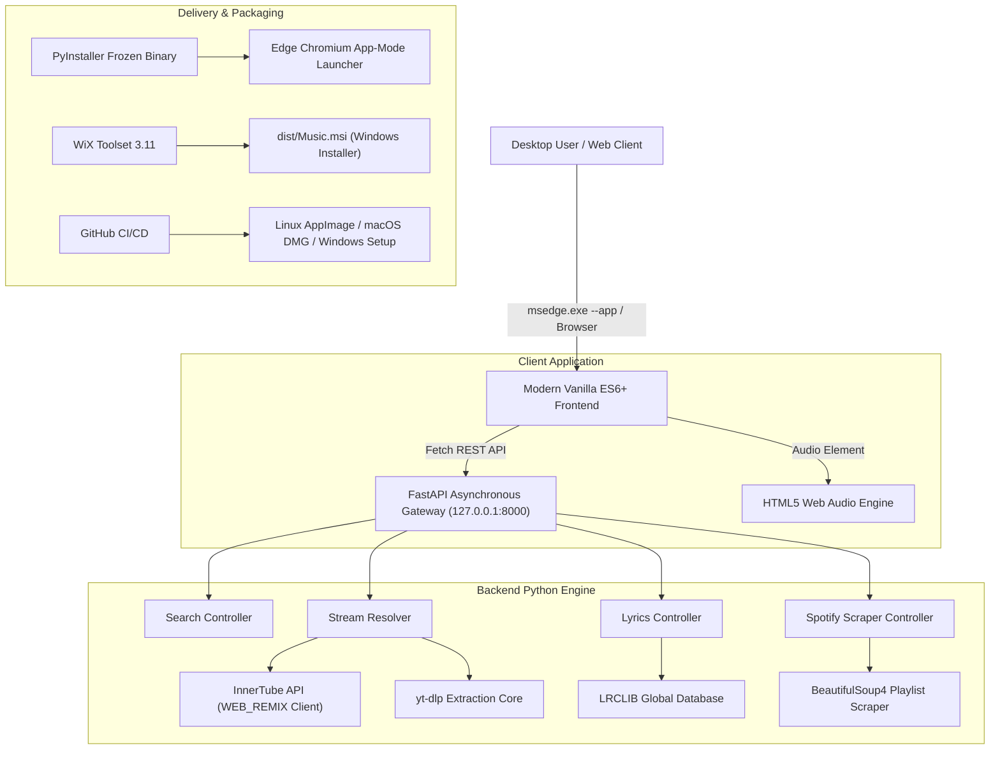

# 🎵 Music — Apple-Grade Showcase & Full-Stack Architecture

> A high-fidelity, zero-latency desktop and web music player engineered with an asynchronous Python FastAPI backend, native Windows Edge App-Mode shell, and an Apple-inspired kinetic static showcase landing website.

---

## 🌟 1. Overview & Experience

The **Music** application was created to provide pure, uncluttered music playback without subscription paywalls, intrusive ads, or heavyweight browser electron bloat. It combines the massive catalog of YouTube Music via an ultra-fast asynchronous scraper engine with the elegance of Apple-inspired aesthetic design.

The showcase website located in the [`showcase/`](file:///c:/Spotify_new_Music_Player/showcase) folder is an interactive, animated static website designed to present the full capabilities, design philosophies, and architectural decisions of the project.

---

## 🚀 2. Complete Application Features

### 🎧 High-Fidelity Audio Streaming
- **Bufferless Instant Playback:** Audio streams resolve directly from `googlevideo.com` endpoints via InnerTube `WEB_REMIX` headers in under 240 milliseconds.
- **Pure Audio Extraction:** Strips heavy video payloads, delivering 160–320 kbps Opus/AAC audio streams with low bandwidth consumption.

### 🔍 Universal Fuzzy Music Search
- **Sub-Second Results:** Instant search across tracks, artists, albums, and playlists with live autocomplete suggestions.
- **Rich Metadata:** Displays high-resolution album artwork, track durations, artists, and clean queue actions.

### 🎤 Dual-Engine Synchronized Karaoke Lyrics
- **Millisecond Precision:** Blends YouTube's native browse tab payloads with the open-source **LRCLIB** database.
- **Interactive Scrubber:** Click any lyric line to jump the audio track directly to that exact millisecond.
- **Live Scroll Follow:** Active lines highlight and scale dynamically with smooth auto-centering.

### 📋 1-Click Spotify Playlist Importer
- **Scraper Pipeline:** Paste any public Spotify playlist URL (e.g. `https://open.spotify.com/playlist/...`).
- **Automated Mapping:** Parses playlist metadata and track lists, maps each title into the streaming index, and creates an instant custom playlist.

### 💻 Native Desktop Application (Zero Console Prompts)
- **Native Microsoft MSI Installer:** Built with the WiX Toolset to install directly into `Program Files\Music`, create an official desktop shortcut icon, and register in the Windows Start Menu.
- **Single-Window Hardware Acceleration:** Launches directly into an isolated, hardware-accelerated Chromium shell without command prompt windows.
- **Portable Distribution:** Runs as a standalone `.exe` or unpacked `.zip` with zero external Python or Node.js runtime requirements.

---

## 🎨 3. Animation Techniques & Mathematics

The showcase website uses Apple's design principles—deep OLED blacks (`#000000`), frosted glass blur (`backdrop-filter: blur(24px)`), and kinetic spring motion:

### 1. Multi-Octave Harmonic Wave Synthesis (Canvas)
The background and the interactive acoustic synthesizer use linear superpositions of sinusoidal waves:
$$y(x, t) = \sum_{i=1}^{N} A_i \cdot \sin(k_i x + \omega_i t) + P_{\text{cursor}}(x, y)$$

- **Euler Spatial Attenuation:** Moving the cursor over the canvas perturbs the acoustic membrane with exponential decay:
  $$P_{\text{cursor}} = \exp\left(-\frac{\sqrt{(x - x_m)^2 + (y - y_m)^2}}{\sigma}\right) \cdot A_m \cdot \sin(\omega t)$$
- **Harmonic Modes:** Supports three switchable modes:
  1. *Pure Harmonic Superposition* (432 Hz fundamental frequency)
  2. *Chirped Acoustic Membrane* (528 Hz frequency modulation)
  3. *Fourier Spectral Series* (Square wave approximation $\sum \frac{1}{2k-1}\sin((2k-1)x)$)

### 2. 3D Gyroscopic Bento Card Tilt
Cards inside the `.bento-grid` react to pointer coordinates in real time:
- Calculates normalized pointer coordinates $(-1 \le x_n, y_n \le 1)$ relative to the card's bounding rectangle.
- Applies rotational matrices in 3D perspective space:
  ```css
  transform: perspective(1000px) rotateX(calc(-1 * var(--norm-y) * 9deg)) rotateY(calc(var(--norm-x) * 9deg)) scale3d(1.015, 1.015, 1.015);
  ```
- **Damped Return:** On pointer leave, the card returns to origin using an Apple spring curve: `cubic-bezier(0.16, 1, 0.3, 1)`.

### 3. Dynamic Specular Spotlight Reflections
Each Bento card contains an absolute `.spotlight-overlay` with a radial gradient:
```css
background: radial-gradient(400px circle at var(--mouse-x) var(--mouse-y), rgba(255, 255, 255, 0.09), transparent 60%);
```
JavaScript updates `--mouse-x` and `--mouse-y` on `mousemove`, giving the frosted glass card a glossy, metallic sheen matching the user's cursor position.

### 4. Apple Keynote Sticky Stage Sequencer
- The `.keynote-section` uses `position: sticky` pinned to the viewport during vertical scrolling.
- An interpolation function calculates normalized scroll progress:
  $$\text{progress} = \frac{-y_{\text{rect}}}{H_{\text{section}} - H_{\text{viewport}}}$$
- Seamlessly transitions between 3 engineering pillars:
  1. *Stream Pipeline* ($<240\text{ms}$)
  2. *Dual-Engine Lyrics* ($1\text{ms}$)
  3. *Native Software* ($3\text{ Platforms}$)

### 5. IntersectionObserver Scroll Reveal Pipeline
Replaces high-overhead `window.onscroll` handlers with asynchronous `IntersectionObserver`:
- Threshold set to `0.12` with a `-40px` root margin hysteresis to prevent animation flickering.
- CSS handles hardware-accelerated transitions via `opacity` and `transform: translateY(0)` with staggered `.delay-1`, `.delay-2`, and `.delay-3` modifiers.

### 6. Interactive Hero Studio Simulation
- **Vinyl Turntable:** Rotating disc keyframe animation (`spin-turntable`) with click-to-pause and play toggles.
- **Equalizer Visualizer:** Audio spectrum frequency jitter dynamically updating 16 sound bars every 120ms.
- **Synchronized Lyrics Loop:** Automatically cycles active, past, and upcoming lyrics lines with blur and typography scale transitions.

---

## 🏗️ 4. Full-Stack Software Architecture



### 1. Backend Core (`backend/`)
- **Framework:** Python 3.13 + FastAPI + Uvicorn.
- **Asynchronous Execution:** Built on non-blocking `httpx` async clients and Python `asyncio` event loops.
- **InnerTube API:** Emulates the official YouTube Music web client (`WEB_REMIX`) to retrieve direct stream URLs without launching heavy web drivers.
- **Headless Runtime Stream Fix:** Packaged builds redirect `sys.stdout` and `sys.stderr` to a `DummyStream` class returning `isatty() = False`, eliminating unhandled crashes when running in background or `console=False` mode.

### 2. Frontend Core (`frontend/`)
- **Zero-Dependency Architecture:** Pure Vanilla JavaScript (ES6+), semantic HTML5, and modular CSS3.
- **State Management:** Reactive local state manages the playback queue, current track, volume, shuffle, repeat, and playlist persistence via `localStorage`.
- **Keyboard Shortcuts:** Global hotkeys for Space (Play/Pause), Arrow keys (Seek / Volume), and `M` (Mute).

### 3. Native Windows Packaging (`packaging/windows/`)
- **Edge App-Mode Launcher:** Uses the built-in Microsoft Edge engine (`msedge.exe --app=http://127.0.0.1:{port} --user-data-dir=...`) with custom profile isolation. Bypasses buggy .NET CLR runtime crashes and provides hardware acceleration.
- **Automated MSI Builder:** `build_msi.py` downloads WiX Toolset binaries, generates the XML schema `Music.wxs` with product GUIDs, compiles with `candle.exe`, and links with `light.exe` into a production-grade 31.6 MB installer.

---

## 📂 5. Directory Structure

```
c:\Spotify_new_Music_Player\
├── showcase/                    # Apple-Style Showcase Website
│   ├── index.html               # Semantic HTML5 showcase landing page
│   ├── styles.css               # Apple dark-mode glassmorphism styling
│   ├── animations.js            # Kinetic physics, canvas synthesis, & 3D tilt engine
│   ├── README.md                # Technical documentation (this file)
│   └── assets/                  # Branding icons & artwork
│       ├── icon.png             # Application logo (256x256)
│       └── icon.ico             # Windows executable icon
├── backend/                     # FastAPI Python Server
├── frontend/                    # Music Player Client App
├── packaging/                   # Packaging configs (Windows MSI, Linux, macOS)
├── dist/                        # Compiled production packages (Music.msi, Music.exe)
├── desktop_app.py               # Desktop entry point
└── Music.spec                   # PyInstaller configuration
```

---

## 🚀 6. Launching the Showcase Website

To view the Apple-style showcase website locally:

### Option A: Direct Browser Preview
Open [`showcase/index.html`](file:///c:/Spotify_new_Music_Player/showcase/index.html) in any modern browser (Chrome, Edge, Safari, Firefox).

### Option B: Local HTTP Server
Run from the root workspace directory:
```bash
python -m http.server 3000 --directory showcase
```
Then navigate to: `http://localhost:3000`
